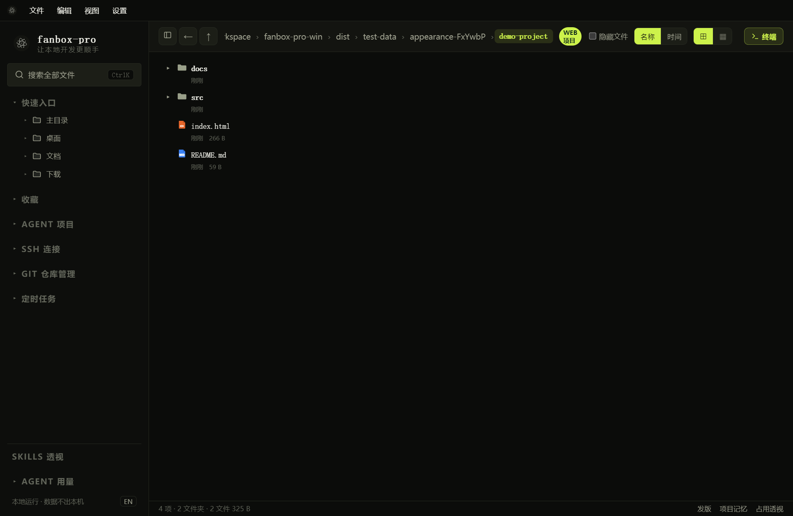

# fanbox-pro 用户指南

**适用版本：Windows 1.0.1 · 文档更新：2026-10-21**

fanbox-pro 将本地文件、终端、SSH、AI 对话、企业微信远程操作和 Git 管理放在同一个工作界面中。本指南按“先配置，再操作，再排查”的顺序说明如何使用。

*图 1：真实应用界面，使用独立演示目录。后文截图中的地址、模型和对话是测试示例，不是可直接连接的线上服务。*

## 从哪里开始

| 我想做什么 | 阅读章节 |
| --- | --- |
| 安装后第一次使用 | [安装与快速开始](getting-started.md) |
| 浏览、搜索、预览或编辑文件 | [文件与编辑器](files.md) |
| 打开本地终端、运行 CLI | [终端与 CLI](terminal.md) |
| 登录服务器、管理远程文件 | [SSH 与快捷命令](ssh.md)、[远程文件](remote-files.md) |
| 配置模型，让 AI 操作终端 | [AI 配置](ai-settings.md)、[AI 对话](ai-chat.md) |
| 在企业微信中远程下发任务 | [绑定企业微信](wecom-setup.md)、[远程交互](wecom-commands.md) |
| Git 同步和定时执行 | [Git 管理](git.md)、[定时任务](schedules.md) |
| 设置主题、宠物或排查问题 | [外观与宠物](appearance.md)、[故障排查](troubleshooting.md) |

## 先理解三个概念

**终端**是命令真正执行的地方，本地终端运行 CMD / PowerShell，SSH 终端连接服务器。

**内置 AI 对话**使用“设置 → AI 配置”中启用的模型，通过当前会话绑定的终端执行命令。它与 Claude、Codex、CodeBuddy CLI 自己的聊天上下文相互独立。

**企业微信桥接会话**属于某个已绑定的企微账号，指向一个本地终端。消息可以交给内置 AI，也可以原样转交该终端里的 CLI。它不是左侧 SSH 会话管理的另一种展示方式。

## 阅读约定

- `设置 → AI 配置` 表示按顺序打开菜单。
- 所有示例路径需要替换为自己的实际路径；`192.0.2.10` 是示例地址。
- 截图中的本机模型地址是截图专用测试服务；不要照抄为生产配置。
- 文档包含步骤、预期结果和异常处理。没有真实企微账号联调截图的部分使用文字示例，不伪造微信聊天界面。
- 本地浏览文件不需要模型；AI 请求及获准的命令结果会发送到所配置的模型服务，企微消息和附件会经企业微信发送。

完整目录见 [SUMMARY.md](SUMMARY.md)。
