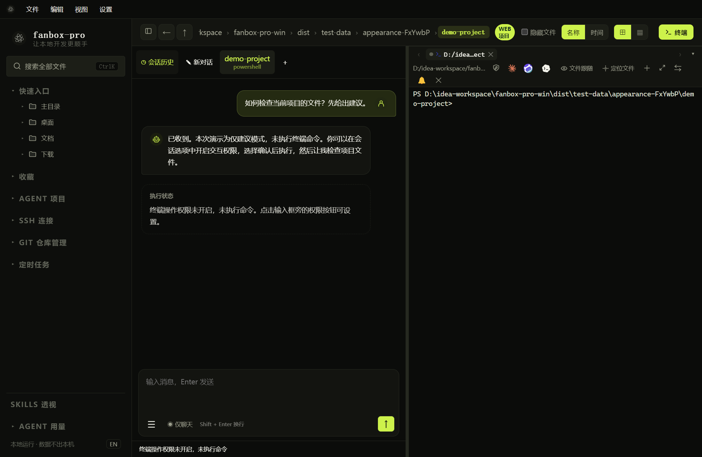
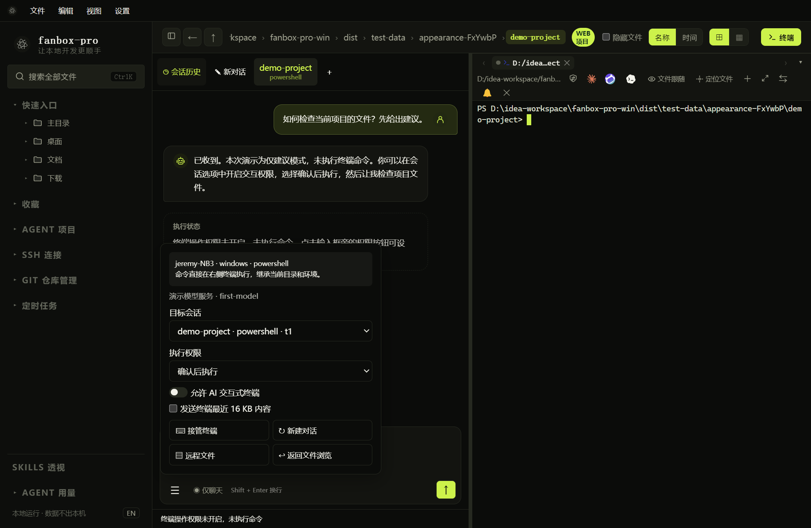
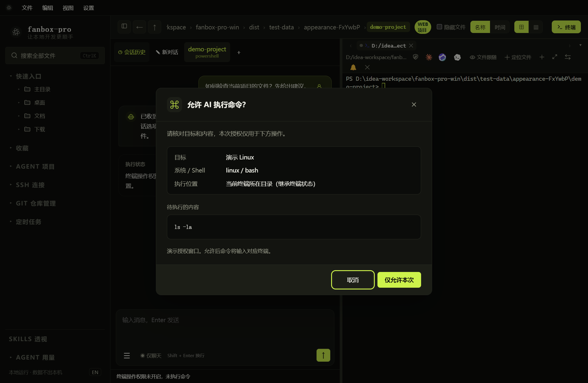

# AI 对话、授权与长任务

## 打开对应终端的 AI 会话

*截图中的回复来自本机演示模型，展示的是未开启执行权限时的状态。*

右键终端标签或 SSH 会话，选择“打开 AI 会话”。左侧是聊天，右侧是绑定终端；顶部可以切换会话。输入框始终位于聊天区域底部，消息区独立滚动。

输入任务后按 Enter 发送，Shift+Enter 换行。用户消息显示在右侧，AI 消息在左侧。模型返回的分析可折叠显示；没有返回分析时只显示实际进度，不补造内容。

## 开启执行权限

1. 点击输入框旁的权限按钮或会话选项图标。
2. 选择“确认后执行”。
3. 开启“允许 AI 交互式终端”。
4. 核对当前目标、系统和 Shell。
5. 发送一个明确的小任务，例如“列出当前目录文件，不修改任何内容”。

| 模式 | 实际行为 |
| --- | --- |
| 仅建议 | 只给建议，没有命令执行工具 |
| 确认后执行 | 普通命令逐条弹窗确认 |
| 自动执行 | 按授权直接执行普通命令；适用于明确且可信任的任务 |

交互输入仍需确认前台程序及目标；开启自动执行不代表所有交互都永久批准。内置 AI 的权限与 CLI 自身的权限模式是两套设置。

## 阅读授权窗口

*此图是用真实弹窗组件打开的授权演示，不会执行图中的命令。*

先看目标和系统，再看命令正文。点击“仅允许本次”后才会发送；取消、关闭或 Escape 都不会批准。长命令可以在命令区域滚动查看。

命令直接写入右侧现有终端，继承当前目录和环境。先让终端回到 Shell 提示符并清除未提交输入。操作和输出以右侧终端为准，AI 聊天不会重复倾倒全部日志。

## 系统识别与目标变化

SSH 系统未知时，AI 会在适合识别的提示符下尝试只读探测。无法可靠识别或检测到手工 SSH / 容器切换时，会阻止盲目执行；按提示选择正确目标或确认系统后再继续。不要根据最初的 Windows 终端类型，假定嵌套登录的 Linux 仍应使用 Windows 命令。

## 长命令会等多久

| 情况 | 当前行为 |
| --- | --- |
| 命令运行超过 1 分钟 | 标记为长时间运行，继续监听 |
| 15 秒没有新输出 | 提示暂时没有新输出，不判定失败 |
| 超过 5 分钟 | 提醒一次，继续等待 |
| 收到 Shell 完成标记 | 认定本条命令结束，AI 分析结果 |
| 用户点击停止 | 发送 Ctrl+C，最多再等 10 秒确认结束 |
| 连接断开 | 报告状态未知，不声称远端进程已被杀掉 |
| 模型连续 5 分钟没有新数据 | 停止等模型回复；此前执行的命令不自动重试 |

命令没有固定最长执行时间。`tail -f`、服务器前台进程等可能一直不结束，应使用有限观察、合适的后台运行方式或人工接管。

## 停止、接管与继续

**停止 AI：**请求中断当前命令，结束后续处理。即使已发送 Ctrl+C，也要看是否收到完成确认。

**接管终端：**不主动中断命令，暂停 AI 的后续操作，让你手动处理。处理完点击“让 AI 继续”，程序重新检查目标、权限与未提交输入；后续命令需要重新确认。

**发送“继续”：**新的一轮会读取最新用户目标、执行结果和中断原因。每轮最多 10 次模型请求，到上限后可以继续；不是只保留最初任务。不要以“继续”替代对未知执行结果的检查。

若你希望 AI 使用本轮之前的手工终端输出，勾选“发送终端最近 16 KB 内容”。AI 自己执行命令得到的结果会作为后续判断依据发送给模型，不依赖这个额外快照开关。
