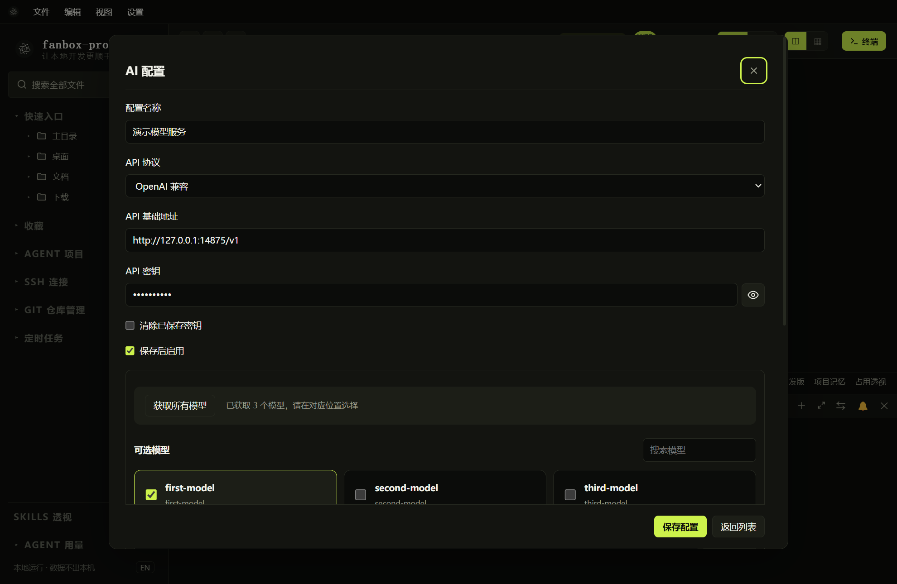
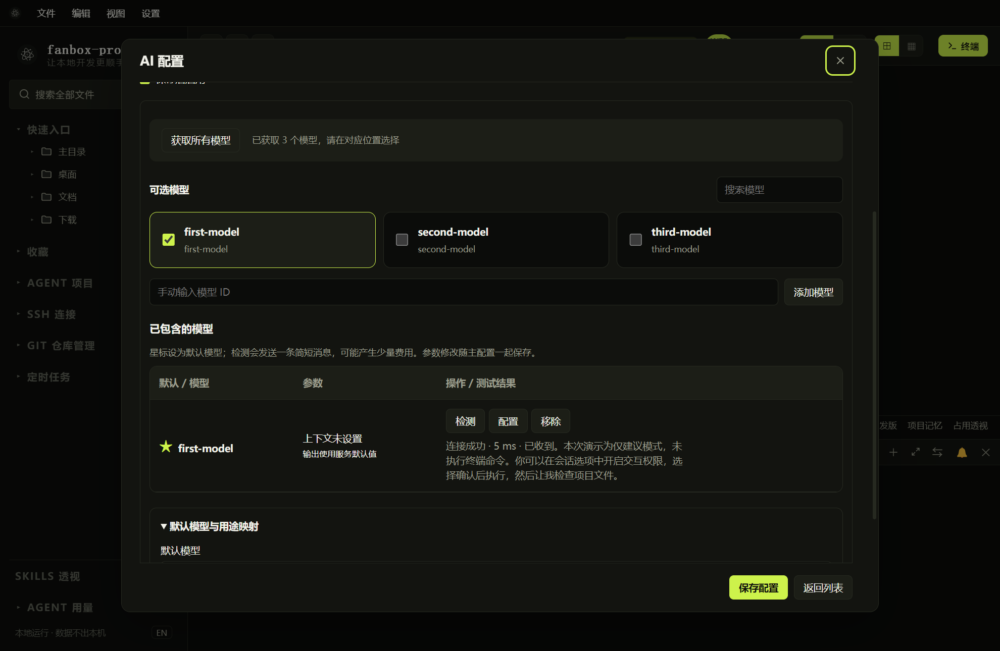
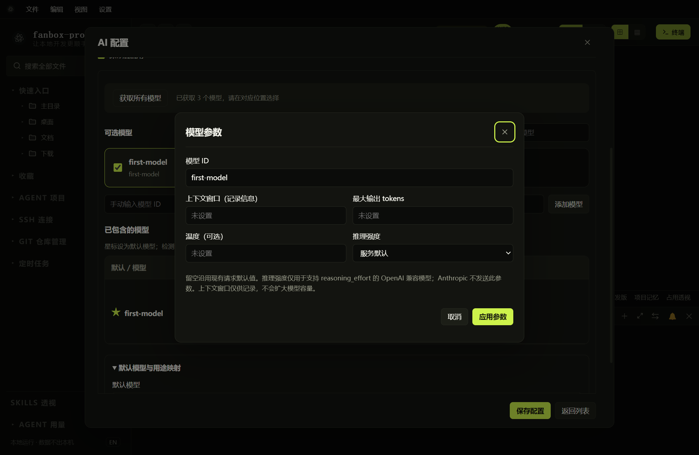

# AI 服务、模型选择与测试

## 新增服务配置

*一套服务共用地址和密钥，可选择多个模型。示例使用本机测试服务。*

1. 打开“设置 → AI 配置”，点击“新增 AI 配置”。
2. 填写名称，选择 OpenAI 兼容或 Anthropic / Claude 协议。
3. 填入服务提供方给出的 API 基础地址和密钥。
4. 点击“获取所有模型”，在返回的模型卡片中选择需要的模型。
5. 指定默认模型或用途映射，保存并启用。

HTTP 与 HTTPS 都支持，必须与服务实际提供的协议一致。例如服务给出 `http://服务器/public/` 时，不要自行改成 `https://`。OpenAI 对话基础地址通常包含 `/v1`；Anthropic 基础地址可以为服务根地址或包含 `/v1`，以服务的兼容接口说明为准。

不要把 `/models` 或 `/chat/completions` 完整接口直接当成对话基础地址。模型列表能获取，只证明列表接口可用，不代表对话接口、模型权限和工具调用都可用。

## 选模型、默认模型与用途映射

*上方卡片用来勾选模型，下方表格用来设置默认模型、检测和调整参数。*

- 使用搜索框筛选模型。
- 勾选模型加入当前配置；没有列表时可手动输入模型 ID。
- 星标表示默认模型；选择默认用途时以用途映射为准。
- Anthropic 可配置 Haiku / Sonnet / Opus 的模型映射，位置可以使用同一个模型。
- OpenAI 兼容配置同样支持单服务内多个模型，不需要为每个模型复制地址和密钥。
- 这些配置用于 FanBox 内置 AI，不会改写 Claude / Codex / CodeBuddy CLI 自己的配置文件。

## 逐个测试与配置参数

点击已选模型行上的“检测”。成功后显示耗时和简短回复；失败显示错误。检测只发送简短测试消息，不操作终端，也不能替代完整工具调用兼容性测试。

| 参数 | 含义 |
| --- | --- |
| 模型 ID | 服务提供方识别模型的名称；不要自行翻译 |
| 上下文窗口 | 记录模型容量的信息，不会扩大模型真实容量 |
| 最大输出 tokens | 本次响应的输出上限；过小可能截断工具参数 |
| 温度 | 可选，服务必须支持此参数 |
| 推理强度 | 用于支持该参数的 OpenAI 兼容模型；Anthropic 不发送此参数 |

修改后点击“应用参数”，最后保存整套配置。检测结果因地址、密钥或参数变化而失效时，应重新检测。

## 启用、停用和密钥查看

同时启用一套 AI 配置。启用后按钮显示“停用”；停用后不会自动切换到其他配置。没有启用配置时不能发起新的 AI 任务。

切换对下一轮任务生效，已在运行的任务请在聊天页停止。密钥默认遮罩，点击眼睛图标查看，再次点击隐藏；编辑时留空通常保留已保存密钥。更换服务地址或协议时，按提示重新输入对应密钥。
