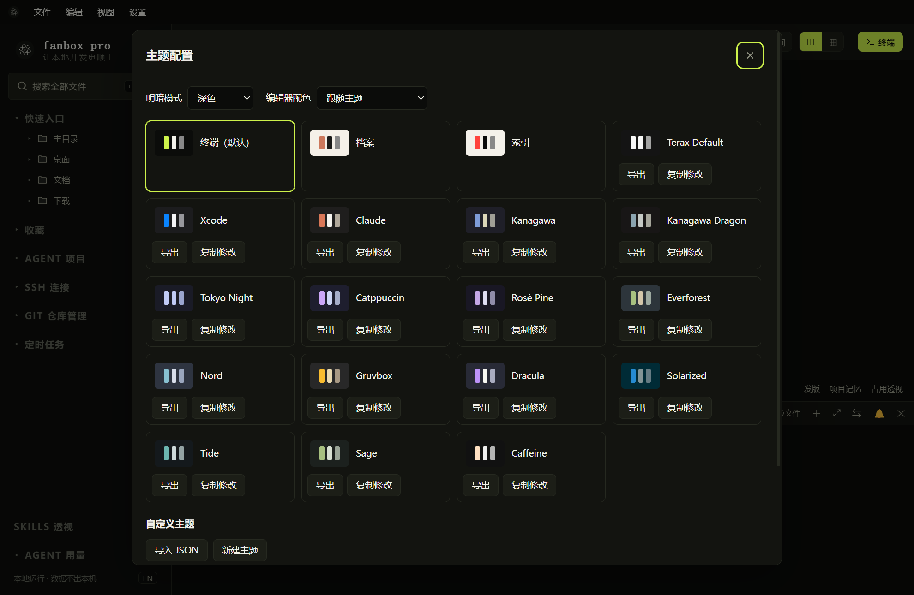
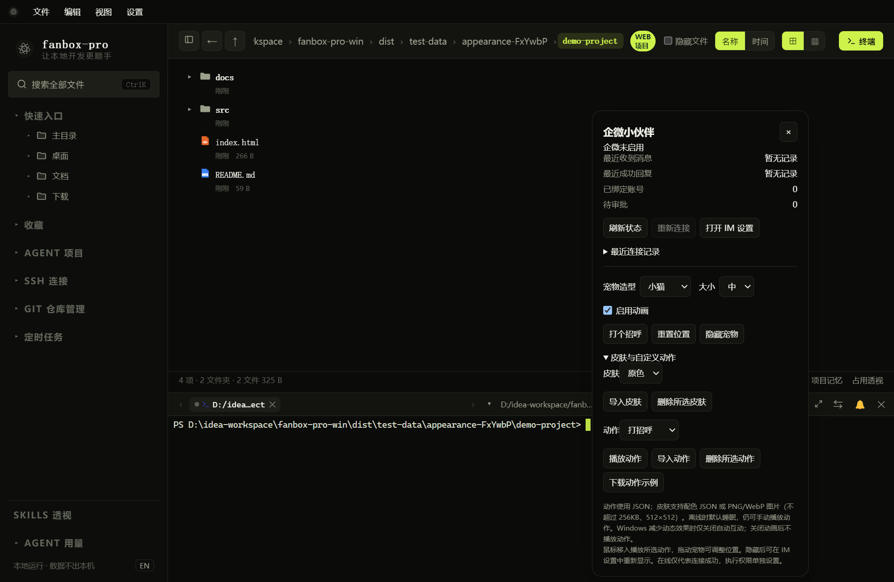

# 主题、桌面宠物与辅助视图

## 主题与背景

打开“视图”中的主题配置，选择主题及深色 / 浅色 / 跟随系统模式。编辑器配色可跟随主题，也可单独选择。

支持导入主题 JSON、新建自定义主题，以及设置背景图片、不透明度和模糊程度。Windows Mica 是系统背景效果，与所选背景图片的透明度和模糊并非同一个选项；是否可用取决于当前系统环境。

## 桌面宠物

*设置面板显示连接状态、动画开关、造型、皮肤和动作；真实机器人连接状态以 IM 页面为准。*

- 软件最小化后宠物仍浮动在桌面。
- 单击宠物显示主窗口；右键打开宠物设置。
- 按住左键拖动宠物改变位置，松开结束拖拽；完成拖拽后不会同时唤出主窗口。
- “重置位置”将宠物移回默认位置，并清理拖拽状态、刷新透明窗口交互区域；设置的宠物大小保持不变。
- 隐藏后可从“设置 → IM 远程干预与通知 → 显示状态宠物”重新显示。此按钮恢复桌面宠物本身，不会同时打开宠物配置面板；需要配置时右键宠物。
- 默认有小猫、小狗、狐狸、机器人，提供原色、奶油、夜空、薄荷等皮肤。

在线时表现活跃，离线时默认睡眠；等待审批或任务处理中也有不同提示。宠物动画不是网络连通性检测的替代品，不能因为它没动就判断机器人离线。

### 右键正常，但左键无法拖动

如果软件运行一段时间后宠物拖不动，但右键仍能打开设置：

1. 右键宠物，点击“重置位置”。当前本地调试包会同时刷新鼠标交互区域，随后重新尝试拖拽。
2. 仍未恢复时，切换一次宠物大小，再改回需要的大小；窗口重排可能恢复交互。
3. 若点击、拖拽仍异常，保存工作后完全退出软件并重新启动，记录是否经历锁屏、休眠或显示器切换。

程序已补充鼠标捕获失败的容错，以及捕获丢失、窗口失焦时的拖拽清理。“重置位置”的交互区域刷新是**手动恢复措施**，没有定时自动刷新，也尚未自动检测这类故障；长期运行是否还会出现需继续实测。

## 动画开关与播放

勾选“启用动画”，选择动作，点击“播放动作”。鼠标移入宠物会触发选定动作。

新版中，手动播放不受机器人在线状态和 Windows“减少动态效果”限制。Windows 要求减少动态效果时，自动互动会减少 / 停止，但你仍可主动点击播放。关闭宠物自身“启用动画”后，所有动作不播放，并提示重新开启。

动作播放中不要频繁切换造型或皮肤；这些操作会重建宠物并中止当前动作。

## 扩展皮肤和动作

- 动作：JSON 格式，最多 32 KB，最多保存 20 个；可下载内置动作示例作为模板。
- 皮肤：配色 JSON 或 PNG / WebP 图片，图片不超过 256 KB、512×512，最多保存 8 个自定义皮肤。
- 导入成功后在下拉框选择；删除操作只针对自定义项。
- 自定义动作通过位置、旋转、缩放关键帧表现，不是任意脚本或 3D 动捕加载器。

动作和皮肤是两个扩展入口：换皮肤改变外观，换动作改变运动。详细字段可参考项目附带的 `docs/pet-actions` 示例。

## Skills 透视和 Agent 用量

左侧“Skills 透视”用于查看本机发现的技能情况；“Agent 用量”用于查看已支持 Agent 的用量信息。数据依赖本机安装、日志和可访问的账户信息，缺失不能当作使用量为零。

“Agent 项目”用于快速回到被 Agent 使用的项目；与 AI 对话历史不是同一个列表。
