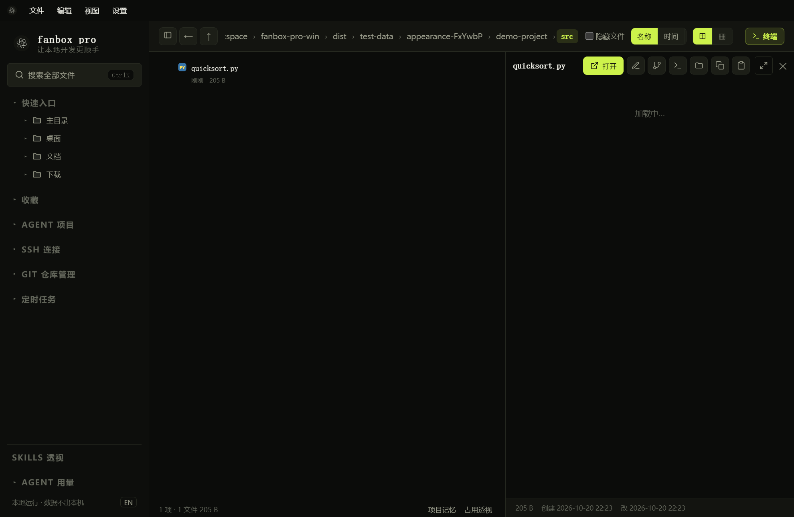
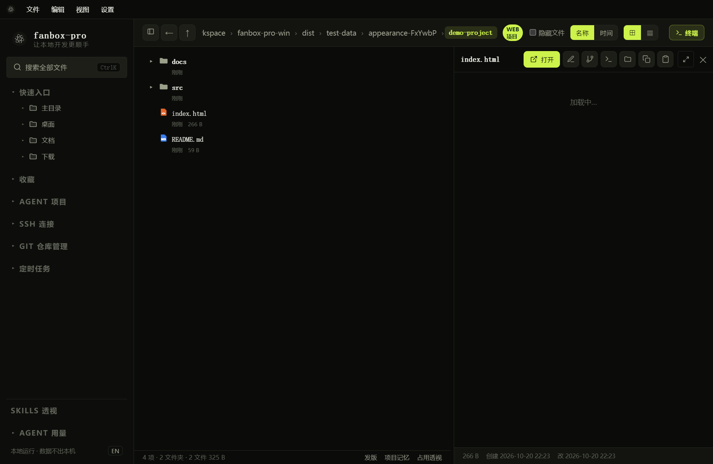

# 文件浏览、搜索、预览与编辑

## 切换目录与视图

首次启动默认采用目录树，后续启动优先沿用你的视图设置。树形、网格、列表可在文件区右上角切换；排序可以选择名称、时间或大小。“隐藏文件”控制隐藏项是否显示。

在目录树中，单击文件夹的展开入口查看子项，双击文件夹进入该目录。文件图标随层级缩进；窄区域优先展示文件名，时间和大小位于辅助信息区域。

右键文件夹，可以找到全部展开 / 全部折叠相关操作。大目录展开需要加载目录内容，请留意进度；它不会使远程 SSH 文件树自动展开。

## 查找文件

1. 点击左侧“搜索全部文件”，或按 `Ctrl+K`。
2. 输入文件名片段。
3. 用 `Tab` 切换搜索范围，使用方向键选择结果、回车打开。
4. 要搜索文件内容，可使用 `内容:关键词`，例如 `内容:quicksort`。

全机搜索的可见结果受可访问目录、索引和文件权限影响。找不到结果时，先进入目标目录再缩小范围搜索。

## 编辑文本与代码

*点击可编辑的代码文件后，右侧出现编辑器；标题栏提供关闭、全屏等操作。*

1. 点击文本或代码文件。
2. 直接在编辑器中修改内容。
3. 按 `Ctrl+S` 保存，并留意保存状态或错误提示。
4. 切换文件前处理未保存修改，避免误放弃。

拖动预览区域边界可调整宽度。点击预览标题栏的全屏图标放大，再次点击恢复；编辑区和终端分别占据自己的区域，长文件在编辑区内滚动。

## 查看 HTML、图片及其他文件

*HTML 默认显示页面效果；图中为本地演示页面。*

图片与 HTML 默认预览，不会像普通代码文件一样直接进入编辑状态。HTML 页面涉及外部网络、脚本或相对资源时，呈现效果还受这些资源是否可访问影响。需要完整开发服务器的项目，应先在终端启动项目，再按项目要求访问页面。

图片可点击放大；其他支持格式按文件类型展示。无法预览时可以通过文件菜单或右键菜单使用外部程序打开。

## 收藏与日常文件操作

文件 / 文件夹右键菜单提供与该项目适用的操作，例如打开、重命名、复制路径、收藏等。收藏入口位于左侧，可折叠。重命名快捷键为 `F2`；执行删除前确认对象与路径。

“Agent 项目”显示已发现的 Agent 项目入口；它与文件收藏、Git 工作区、SSH 分组不是同一份列表。

## 文件跟随

终端工具栏的“文件跟随”用于跟随当前 Agent 操作的文件，适合一边执行任务一边查看 HTML / Markdown 的变化。手动浏览会停止跟随；想固定看某个文件时，关闭跟随即可。
