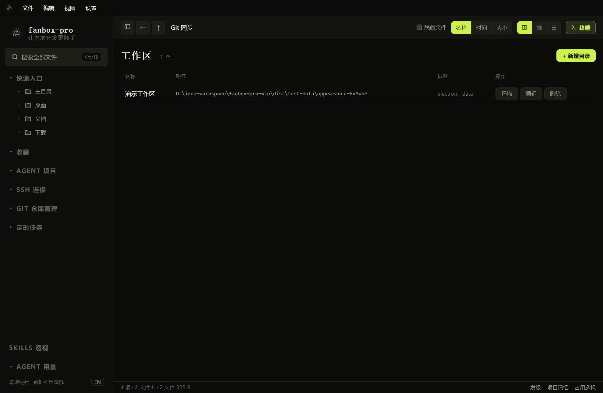
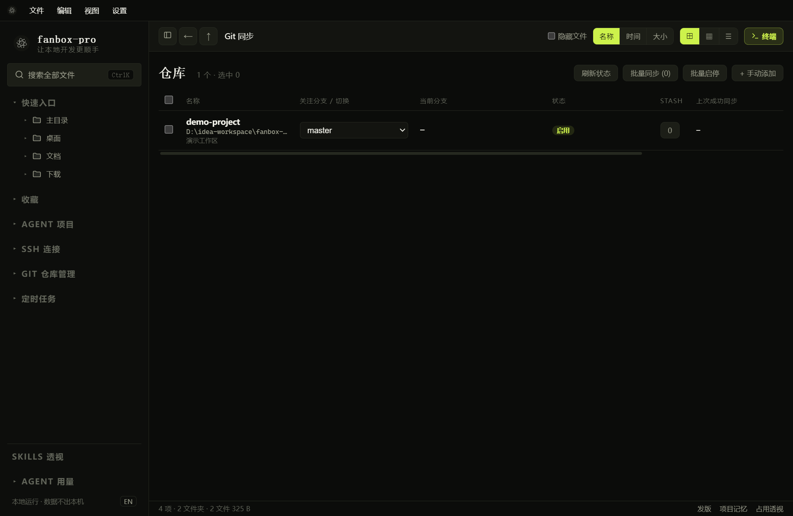

# Git 工作区、仓库与同步

## 添加工作区

*工作区是扫描仓库的目录范围，不是 SSH 分组或企微会话。*

1. 展开“Git 仓库管理”，打开“工作区”。
2. 新增工作区并填写本机绝对路径。
3. 保存后执行扫描。
4. 打开“仓库”，查看扫描到的仓库。

工作区可以设置名称和排除目录。删除工作区会移除相应管理记录，应先核对范围；日常文件删除与 Git 管理记录删除是不同操作。

## 仓库操作

*仓库页显示可管理仓库；空列表时先添加工作区并扫描。*

在仓库行或更多菜单中查看分支、同步状态、运行结果等。选择目标分支后再同步 / 切换，不要仅根据仓库名称判断当前代码分支。

网络认证由本机 Git 环境决定；SSH 密钥、远程权限或 HTTP 凭据不正确时，查看具体错误并先确认本机 Git 能访问远端。

## 遇到“脏工作区”

脏工作区表示有未提交修改，直接切分支或更新可能覆盖 / 冲突。按目的选择：

| 选择 | 适合情况 |
| --- | --- |
| 提交改动 | 修改已完成，希望保留为本地提交 |
| Stash 暂存 | 修改未完成，想临时收起再切换 / 同步 |
| 稍后处理 | 暂不改变工作区，先人工查看 |
| 丢弃改动（若相应菜单提供） | 确定不再需要本地改动，执行前核对范围 |

处理时留意按钮忙碌状态和进度。处理完成后刷新当前仓库状态，再执行同步；遇到冲突应检查文件和 Git 状态，不要连续重复点击。

Stash 是临时保存，不等于提交或推送；后续通过 Stash 管理恢复时仍可能发生冲突。

## 自动同步与日志

“自动同步”中创建任务，选择仓库与执行计划。与普通“定时任务”是两类入口：前者面向仓库同步 / 管理任务，后者面向 Shell 或 Agent 工作。

“同步日志”用于查看每次执行的结果和错误。完成一次手动同步并确认配置有效后，再启用周期任务。
