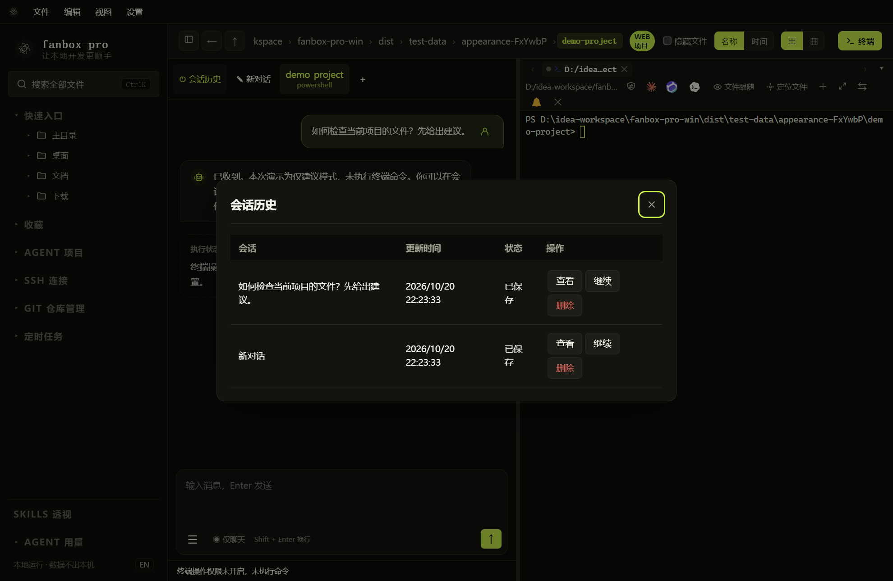

# 会话历史与上下文

## 查看、继续或删除

*入口位于对应 AI 会话顶部，不在顶层设置菜单中。*

1. 打开要查看的终端 AI 会话。
2. 点击“会话历史”。
3. 在表格中按标题、更新时间和状态查找记录。
4. 点击“查看”阅读，或点击“继续”恢复到当前对应终端。
5. 不再需要时点击“删除”，核对确认弹窗中的会话名称。

删除记录不可恢复，但不会删除项目文件或 SSH 连接配置。运行中的记录不能直接删除，应先停止任务。

“新对话”保留旧历史并开始新的上下文；它与删除历史不同。

## 绑定规则

一个终端绑定一段对话。不同终端默认不共享上下文，即便连到同一台服务器也是如此。一段历史不能同时绑定两个终端；可在原终端继续，或先关闭原终端，再在匹配目标的连接中恢复。

SSH 历史按对应连接与服务器身份区分。本地历史按机器和 Shell 区分。企微桥接的会话还有其自身归属，不能通过编号去访问其他账号的会话。

## “继续”时模型看到了什么

同一运行中的终端会保留最近对话、工具调用、结果以及中断信息。正常完成、超时、取消、达到步数上限都会更新上下文；结果未知的操作会明确标记未知，不应直接重试。

较长历史会保留近期对话，对更早内容做有损摘录，较长工具输出会省略中间部分。这不是无限记忆，也不是完整逐字归档；涉及很久以前的约束，建议重述关键条件。

## 重启后的限制

磁盘历史保存用户消息、AI 回复、服务返回的分析、命令标记、错误和状态。**不保存原始终端输出、运行进程或授权状态。**

从历史恢复时，模型能看到最近文字和命令说明，但无法据此证明旧命令成功完成；应先检查终端当前状态。软件退出时未结束的任务不会自动重跑。旧版本没有保存下来的信息无法恢复。

消息区默认展示最近一部分记录，可加载更早消息；显示范围与发给模型的上下文范围并不完全相同。
