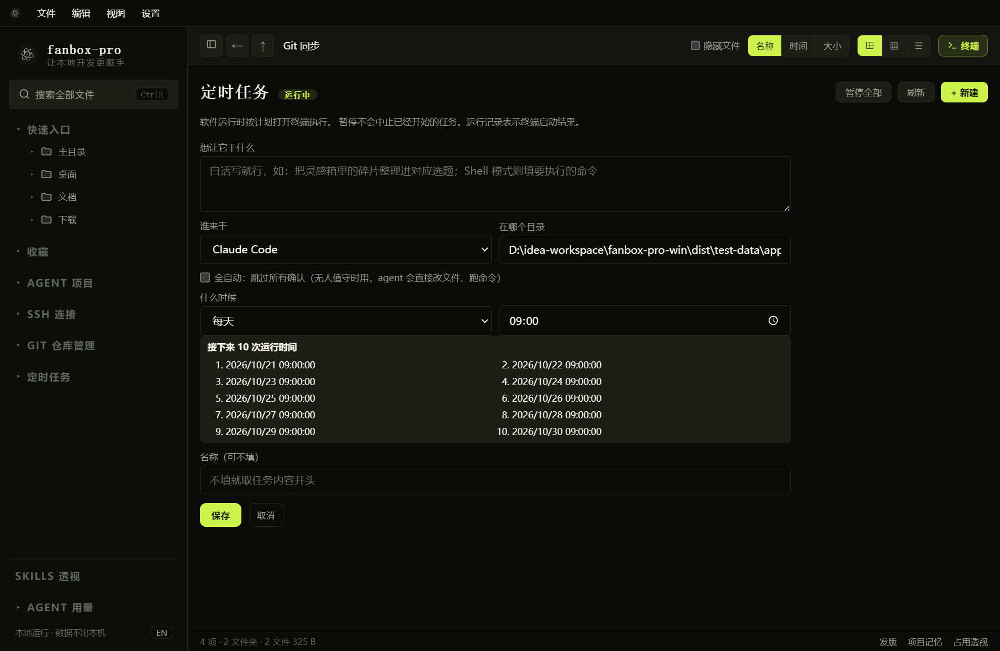

# 定时任务

## 新建任务

1. 展开左侧“定时任务”，进入“任务管理”。
2. 点击“新建”。
3. 在“想让它干什么”中填写工作说明；Shell 模式填写具体命令。
4. 在“谁来干”中选择 Claude Code、Codex 或 Shell 命令。
5. 填写实际工作目录。
6. 设置一次性、周期或 Cron 等计划，填写名称并保存。

例如创建一次性 Shell 检查任务，先用不会修改文件的命令验证环境。Agent 任务要求相应 CLI 已安装并能登录，内置 AI 模型配置不替代 CLI 登录。

## 自动执行与运行条件

“全自动：跳过所有确认”允许 Agent 直接改文件、运行命令，适用于已验证的无人值守任务；没有开启时，交互确认可能使任务等待。

软件需要保持运行，电脑休眠或程序退出期间无法按时执行。界面可能提示某次计划因 FanBox 未开启而跳过，不要假定所有错过任务都会自动补跑。

## 暂停、恢复和查结果

页面上的“暂停全部”影响该调度器，恢复后按计划继续。单个任务可按界面提供的操作启用、停用、编辑、运行或查看记录。

计划任务的运行记录可能仅表示终端启动结果，不等于 Agent 已经完成工作。暂停调度也不会中止已经开始的任务。先检查实际终端或日志，再判断任务结果、修改计划。计划任务的超时和运行限制与内置 AI 对话等待策略不一定相同，不要用“AI 命令无固定最长等待”推断所有计划任务都无限运行。
