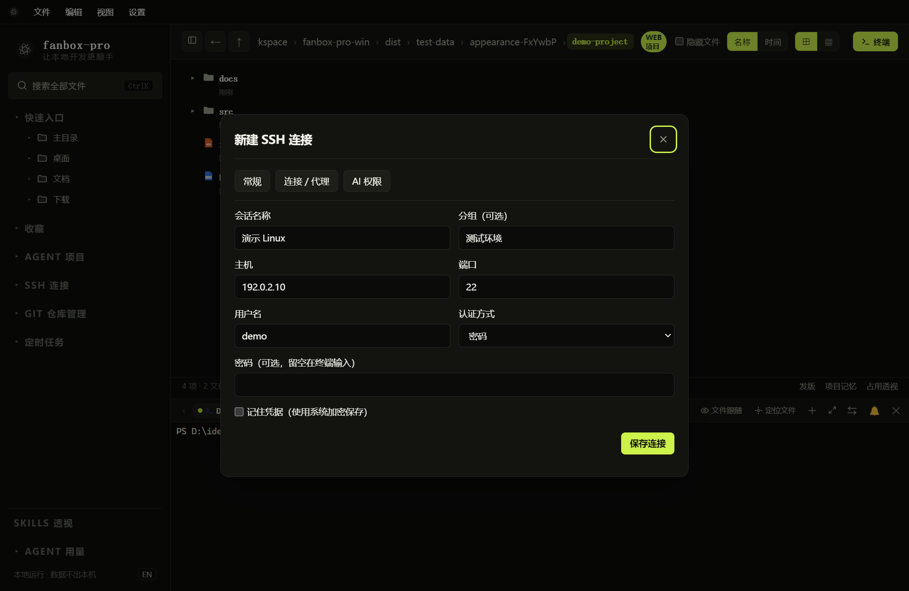

# SSH 会话与快捷命令

## 新建连接



*通过左侧 SSH 连接 → 会话管理旁的 ＋ 打开。示例地址不可用于实际登录。*

1. 展开左侧“SSH 连接”。
2. 点击“会话管理”旁的 `＋`。
3. 在常规页填写连接名称、分组、主机、端口、用户名。
4. 选择密码或私钥认证。
5. 保存后展开会话管理树，点击连接名称登录。

分组先显示，连接位于对应分组下；未分组连接单独列出。右键连接可编辑、删除、打开 AI 会话、访问远程文件或管理快捷命令。删除连接配置前，先确认它是否仍被使用。

## 密码、私钥与首次验证

- 填写了可用密码时直接认证；不填密码时，终端停在 `password:` 等待输入。
- 密码输入不回显。输入错误后会提示重新输入，单次连接最多尝试 3 轮；服务器策略可能更早断开。
- 未勾选“记住凭据”时，重启后需要重新输入。
- 私钥认证需要选择本地私钥，若有口令则填写口令；支持服务器要求的交互认证。
- 首次连接会显示主机指纹，请与服务器提供者核对。指纹变化时不要直接当作普通密码错误处理。
- `Ctrl+C` 可取消当前认证。

## 堡垒机、跳板与代理

在连接 / 代理分类中设置终端类型、系统检测、跳板机以及 SOCKS5 / HTTP CONNECT 代理。通常先用默认项完成直连，再增加网络设置。

齐治等堡垒机场景优先使用 `xterm`。登录出现 `Please re-login` 时，检查终端类型，并关闭普通 SSH 的提前系统检测；堡垒机可能把额外探测当作一次登录会话。AI 在适合探测的 Shell 提示符下会尝试识别目标系统，但无法确认时不会盲目执行命令。

跳板机需先保存为连接，再在目标连接中选择。代理应配置在实际对外建立网络连接的那一层；使用跳板时留意代理位置。

## 快捷命令分组

1. 在对应 SSH 连接上右键，进入新增 / 管理快捷命令。
2. 填写快捷名称、分组和多行命令。
3. 保存后，在该连接的终端右键，按“快捷指令 → 分组 → 命令”选择。
4. 输出直接在终端查看。列表默认显示名称，可点“查看”展开命令正文。

例如创建“检查目录”分组下的“查看配置”：

```sh
cd /home/demo
ls -la
cat test.txt
```

快捷命令按顺序输入当前终端，**不会等待每行命令完成后再决定下一行**。不要把需要密码、交互选择或长驻程序的多行流程当作自动化脚本使用。它只属于对应 SSH 连接，不会自动出现在其他连接下。

## SSH 与企微会话不合并

SSH 管理保存服务器连接参数；企微 `/new` 创建的是桥接终端会话。它们各自维护会话，不因项目名或用户名相同而共享历史。
