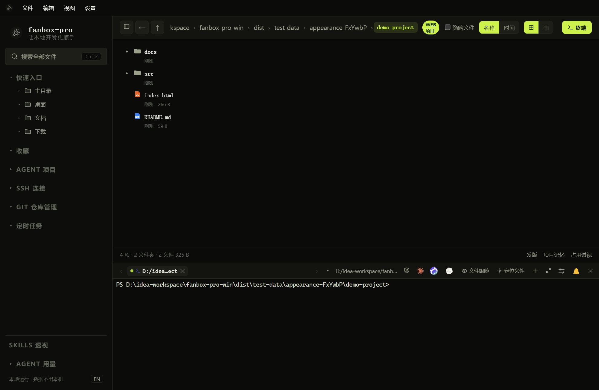

# 本地终端与 CLI

## 打开、切换和调整终端

*终端在当前项目目录启动；提示符可以确认当前 Shell 与目录。*

1. 在文件区进入项目目录，点击“终端”。
2. 使用 `＋` 新建终端，通过标签切换。
3. 标签过多时使用左右滚动箭头或全部标签列表。
4. 拖动分隔条调整大小；使用布局按钮切换上下 / 左右排列。
5. 使用铺满图标放大终端，再次点击恢复。

“收起终端”用于收起面板；关闭某个标签会关闭对应终端。两者不要混淆。进程退出后，界面会提示回车重开或关闭标签。

“定位文件”把文件区切到当前终端目录。路径拖入终端可用于输入文件路径，提交前检查带空格路径的引用是否正确。

## CMD 与 PowerShell 命令示例

| 目的 | CMD | PowerShell |
| --- | --- | --- |
| 列出目录 | `dir` | `Get-ChildItem` |
| 显示当前目录 | `cd` | `Get-Location` |
| 进入项目 | `cd /d D:\code\demo` | `Set-Location D:\code\demo` |
| 显示文本 | `type README.md` | `Get-Content README.md` |

Linux 的 `ll` 并非 Windows 通用命令；即便在 Linux 上，它也可能只是用户自定义别名。

中文输入按输入法正常选词，确认候选词后再回车提交命令。选词期间的回车不应直接提交终端命令。

## 启动 Claude、Codex、CodeBuddy

前提是相应 CLI 已安装、能在终端找到命令，并已完成登录或自己的模型配置。FanBox 的 AI 配置不会改写这些 CLI 的全局配置。

终端工具栏提供三个 CLI 图标。空闲终端可原地启动，忙碌时可能新建标签；以实际新标签和进程提示为准。

> 当前版本的本地 Claude 快捷图标使用跳过权限确认的启动参数。希望保留 Claude 默认审批时，请在终端手动输入 `claude`。企业微信 `/claude` 的桥接启动流程与此本地图标不同，仍处理信任与权限交互。

Claude 底部出现 `shift+tab to cycle` 时，可使用工具栏权限图标切换模式。查看切换后的实际状态，不要把“发送按键”当作切换成功。

## 手动终端与内置 AI 的区别

终端键盘输入直接到 Shell / CLI。内置 AI 输入框中的文本先发送给启用的模型，由模型决定是否调用工具。已经进入 CLI 的企微会话会把普通消息原样发送给 CLI，详见 [企业微信命令](wecom-commands.md)。

滚轮用于查看回滚内容，不代表重新执行命令。拖动分隔条会改变终端尺寸，CLI 可能重绘自己的界面；若发现异常重复，记录发生时是滚动还是改变尺寸，便于排查。
