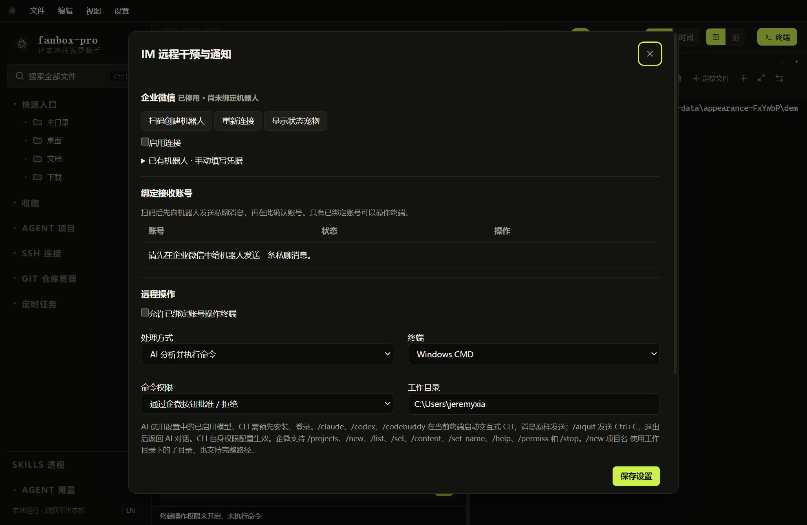
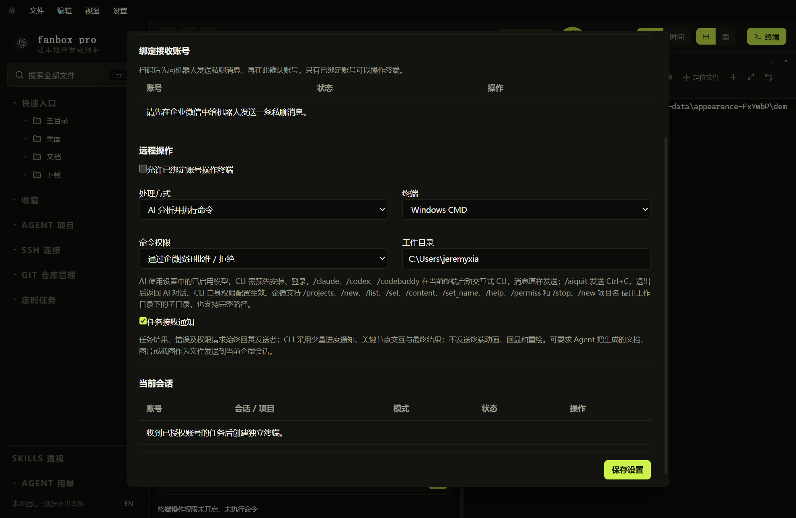

# 企业微信机器人绑定

## 配置入口



*入口：设置 → IM 远程干预与通知。截图未绑定真实机器人。*

需要运行 FanBox 的电脑保持开机、软件运行，并能连接企业微信服务。手机上的企业微信不替代电脑上的执行环境。

## 扫码或手动添加

1. 打开 IM 设置，点击“扫码创建机器人”。
2. 使用企业微信扫码并完成界面要求的确认；二维码通常 5 分钟有效。
3. 如果扫码不可用，可展开手动凭据，填写已有智能机器人的 Bot ID 和 Secret。
4. 启用机器人并保存，检查连接状态与错误提示。
5. 用准备绑定的企业微信账号给机器人发送一条私聊消息。
6. 回到电脑端，在接收账号列表中确认并绑定。

只填凭据不等于完成账号绑定；只有已绑定账号才可以操作终端。扫码结果、组织权限和网络条件可能影响创建流程，遇到失败按页面错误处理。

Secret 默认遮罩，可通过眼睛图标查看 / 隐藏。提示凭据无法解密时，重新扫码或重新填写 Secret 后保存，不要把空输入当作已经恢复凭据。

## 配置执行环境



| 设置 | 如何选择 |
| --- | --- |
| 允许已绑定账号操作终端 | 开启后才允许远程执行 |
| 处理方式 | AI 分析并执行，或默认使用某个 CLI |
| 终端 | Windows CMD 或 PowerShell |
| 命令权限 | 初次使用选择通过企微按钮批准 / 拒绝 |
| 工作目录 | 已存在的本地目录，例如 `D:\code` |
| 任务接收通知 | 控制接收提示；结果、错误、权限请求仍会回复 |

点击“保存设置”，应显示“保存成功”或具体失败原因。改变连接或处理方式可能使现有桥接路由结束，下次消息创建新会话；修改前先结束正在执行的任务。

## 首次验证

在企微发送以下消息，逐步确认：

```text
/projects
/new demo
/list
请告诉我当前终端的系统和目录，先不要修改文件。
```

`demo` 应替换为工作目录下实际存在的项目。内置 AI 处理需要启用有效的 AI 配置；CLI 处理需要本机 CLI 安装及登录完成。

当手机发消息没反应时，优先查看 IM 页面的连接状态、绑定账号和执行授权，而不是仅看宠物是否在动。
